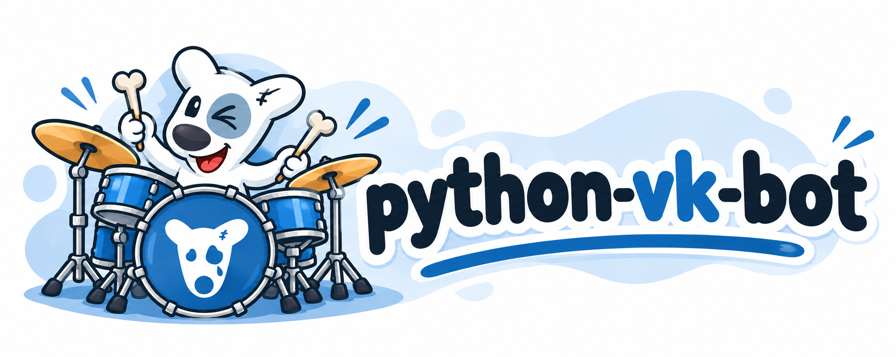

<p align="center">
  
</p>

[](https://pypi.org/project/python-vk-bot/)
[](LICENSE)

# python-vk-bot

An asynchronous framework for VK community bots, inspired by python-telegram-bot.
Supports **Python 3.9–3.14** and VK API **5.199**.

## Installation

Install the `compat/py39` branch directly from GitHub:

```bash
uv add git+https://github.com/fomenko-ai/python-vk-bot.git --branch compat/py39
```

### Install from this checkout

```bash
uv sync --locked
```

For the optional Callback HTTP receiver:

```bash
uv sync --locked --extra callback
```

## Examples

See the [examples guide](examples/README.md) for setup, required events and run commands.

| Example | Description |
| --- | --- |
| [Echo bot](examples/echo.py) | Reply to text messages using Bots Long Poll |
| [Keyboards](examples/keyboards.py) | Text, callback, link and location buttons; typed snackbar answers and message editing |
| [Interactive map](examples/interactive_map.py) | Generate, upload and replace a PNG using navigation buttons |
| [Callback receiver](examples/callback.py) | Receive events through an ASGI application |
| [Background result](examples/background_result.py) | Return a local calculation through the unified event queue |
| [Donut subscriptions](examples/donut_subscriptions.py) | Receive five typed subscription events and inspect the latest notification |

## Long Poll bot

Enable Bots Long Poll and the `message_new` event in the community settings. Configure
its event version to match the supported API schema. Supply a community token with the
required permissions through the environment; messaging is subject to VK's conversation
and permission rules.

```python
import asyncio

from python_vk_bot import Application, Bot, BotSettings, Context, MessageHandler, Update, filters


async def echo(update: Update, context: Context) -> None:
    message = update.message
    if message is not None:
        await context.bot.send_message(message.peer_id, message.text)


async def main() -> None:
    settings = BotSettings()
    bot = Bot(settings.token, api_version=settings.api_version, timeout=settings.timeout)
    app = Application(bot, settings.group_id)
    app.add_handler(MessageHandler(echo, predicate=filters.TEXT))
    await app.run_polling(wait=settings.polling_wait)


asyncio.run(main())
```

With `VK_TOKEN` and `VK_GROUP_ID` already set, run the included example:

```bash
uv run python examples/echo.py
```

`run_polling()` is awaitable. Cancellation closes owned resources. Handlers run
sequentially, with the first match in each numeric group. `Context` exposes `bot`,
`user_data`, `peer_data` and `bot_data`. Use `MessageEventHandler` for button events,
`filters.LOCATION` for messages containing geo, and `CommandHandler` for `/command` tokens.

## Settings

Import `BotSettings` from `python_vk_bot` or `python_vk_bot.settings`. It uses
`pydantic-settings` to load and validate configuration when you create an instance.
Importing the module does not read configuration or require credentials.

| Field | Environment variable | Default |
| --- | --- | --- |
| `token` | `VK_TOKEN` | Required, nonempty `SecretStr` |
| `group_id` | `VK_GROUP_ID` | Required, positive integer |
| `api_version` | `VK_API_VERSION` | `"5.199"` |
| `timeout` | `VK_TIMEOUT` | `40.0` seconds, positive and finite |
| `polling_wait` | `VK_POLLING_WAIT` | `25` seconds, between 1 and 90 |

Use environment variables directly:

```python
from python_vk_bot import BotSettings

settings = BotSettings()  # Read VK_* variables; no automatic .env loading.
```

Alternatively, opt into a dotenv file and override a value for this instance:

```python
from pathlib import Path

from python_vk_bot import BotSettings

settings = BotSettings(_env_file=Path(".env"), timeout=15.0)
```

Explicit constructor values take precedence over environment variables, which take
precedence over dotenv values and field defaults. Unrelated dotenv entries are ignored,
so a project may share its `.env` with other components. Unknown constructor fields are
also ignored; use `extra="forbid"` in a subclass if you prefer strict configuration.
Settings only contain configuration: pass their values to `Bot`, `Application` and
`run_polling` explicitly as shown above. Keep real tokens and `.env` out of Git.

Extend the class with your project's fields:

```python
from pathlib import Path

from pydantic import Field

from python_vk_bot import BotSettings


class ProjectSettings(BotSettings):
    admin_ids: list[int] = Field(default_factory=list)
    debug: bool = False


settings = ProjectSettings(_env_file=Path(".env"))
```

These fields read `VK_ADMIN_IDS` (a JSON array such as `[123, 456]`) and `VK_DEBUG`
(for example, `true`). Override `model_config` with `SettingsConfigDict(env_prefix="MYBOT_")`
to use another prefix. A field with `Field(validation_alias="DATABASE_URL")` instead reads
that exact variable name, without the prefix. Token values remain `SecretStr` and can be
passed directly to `Bot`.

## Bot without polling

```python
async with Bot(token) as bot:
    user = await bot.get_user_info(user_id)
```

An injected `httpx.AsyncClient` remains caller-owned. Methods cover uploading, sending,
editing, deleting, forwarding, fetching a message/user, answering message events, and obtaining Long Poll
connection data. `Bot.request(method, parameters)` exposes raw JSON results for additional
VK methods; nested request parameters must be JSON encoded explicitly.

Messages use `peer_id`; `Message` exposes both `id` and `conversation_message_id`.
`send_message` returns an integer message ID and accepts an optional nonzero int32
`random_id`. Sends are never retried automatically. `edit_message` accepts exactly one
message identifier and maps `conversation_message_id` to VK's `cmid` parameter.

## Callback API

The [Callback example](examples/callback.py) extends the same base settings with its
required secrets. For example, to construct a receiver from the environment:

```python
from pydantic import Field, SecretStr

from python_vk_bot import Application, Bot, BotSettings, Callback


class CallbackSettings(BotSettings):
    callback_secret: SecretStr = Field(min_length=1, repr=False)
    callback_confirmation: SecretStr = Field(min_length=1, repr=False)


settings = CallbackSettings()
bot = Bot(settings.token, api_version=settings.api_version, timeout=settings.timeout)
application = Application(bot, settings.group_id)
# Register your handlers before starting the ASGI application.
callback = Callback(
    application,
    secret=settings.callback_secret,
    confirmation_code=settings.callback_confirmation,
)
asgi_app = callback.create_app()
```

Set `VK_TOKEN`, `VK_GROUP_ID`, `VK_CALLBACK_SECRET`, and `VK_CALLBACK_CONFIRMATION`, then:

```bash
uv run --extra callback uvicorn examples.callback:create_app --factory
```

Expose `/callback` through your HTTPS deployment and configure the same secret in VK.
ASGI lifespan manages startup/shutdown. `Callback.handle()` is also available for other
HTTP frameworks, provided the caller manages Application's async lifecycle.

Confirmation returns the configured confirmation code. Ordinary events return `ok` only
after successful processing. A bounded in-memory cache skips successful duplicates.
Partial handler failures, restarts and multiple workers can repeat side effects; this
is not a durable queue or an exactly-once processing guarantee. See the architecture
for delivery limitations and resource limits.

## Media and location

With an initialized bot:

```python
from pathlib import Path

photo = await bot.upload_photo(peer_id, Path("map.png"))
message_id = await bot.send_message(peer_id, "Map", attachment=photo, keyboard=keyboard)

document = await bot.upload_document(peer_id, Path("report.pdf"))
await bot.send_message(peer_id, "Report", attachment=document)

await bot.edit_message_media(
    peer_id,
    new_png_bytes,
    message_id=message_id,
    caption="Updated map",
    keyboard=keyboard,
    filename="map.png",
)
```

Uploads accept bytes, `Path` and binary file objects. Files are read off the event loop
and buffered in memory; use inputs that fit comfortably in memory. Existing attachment
identifiers can be passed directly to send/edit methods, and a saved photo passed to
`edit_message_media` skips uploading. Supply the desired caption and keyboard explicitly;
there is no automatic fallback send when editing fails.

Incoming `message.attachments` remain raw dictionaries. Use `message.typed_attachments`
for `PhotoAttachment`, `DocumentAttachment`, `VideoAttachment`, `AudioMessageAttachment`
or a generic `Attachment` preserving unknown fields. With `message.geo is not None`,
read `message.geo.coordinates.latitude` and `.longitude`; `filters.LOCATION` selects
these messages. Incomplete coordinate objects fail validation.

See the [media API guide](docs/development/media-api.md) for incoming attachment examples,
deletion, errors and VK restrictions, and [interactive_map.py](examples/interactive_map.py)
for a PNG grid with navigation buttons. Enable `message_new` and `message_event`, then run:

```bash
uv run python examples/interactive_map.py
```

The media API has network-free regression tests. Actual replacement of a photo in an
existing VK message has not yet been verified with a live token; an explicitly enabled
[integration test](docs/development/media-api.md#live-integration-test) is provided.

## Background tasks and internal events

Use `Application.create_task()` for background operations and `update_queue.put()` to
return Python objects to the shared serial dispatcher. `TypeHandler` routes these results;
`ApplicationHandlerStop` skips later handler groups for the current event. See the
[background-result example](examples/background_result.py).

The application manages task completion and calls `post_stop` before closing Bot.
Queue capacity, state scopes, cancellation, workers and shutdown are described in the
[event processing guide](docs/development/event-processing.md). The queue is in memory
and does not preserve work across restarts.

## VK Donut events

Register `DonutSubscriptionHandler(on_donut)` through `Application.add_handler` to receive
all five subscription Callback events. Inside the async callback, `update.donut_subscription`
provides the typed object and `update.user_id` selects the subscriber's `context.user_data`.
Use `event_types` or composable `filters.DONUT_SUBSCRIPTION_*` predicates to select events.

These are subscription-change notifications, not a synchronized subscriber list or a paid
access check. See the [Donut guide](docs/development/donut.md) for setup, models, filtering,
delivery limitations and the runnable example.

## Agent Skills

The bundled **telegram-to-vk** Agent Skill helps AI coding agents migrate
`python-telegram-bot` applications to VK using `python-vk-bot`.

After installing a package version containing the skill, run from your bot project's root:

```bash
uvx library-skills
```

Select `telegram-to-vk` and the `.agents/skills` target for a compatible AI coding agent.
The skill adds no runtime dependencies and does not change the framework's behavior.
See [Agent Skills](docs/agent-skills.md) for package installation, installing from a local
checkout, and usage examples.

## Documentation

- [Architecture and lifecycle](docs/architecture/project-architecture.md)
- [python-telegram-bot design mapping](docs/architecture/python-telegram-bot-compatibility.md)
- [VK API support](docs/development/api-compatibility.md)
- [Contributing and verification](CONTRIBUTING.md)
- [Python compatibility branch](docs/development/python-compatibility.md)
- [Changelog](CHANGELOG.md)
