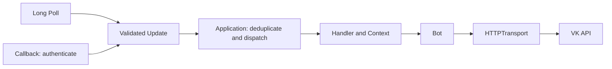

# Project architecture

Status: implemented with network-free regression coverage. Python 3.14 baseline.

## Design goals

The library separates asynchronous HTTP, VK methods, validated events, delivery,
dispatch and application state. Its public API focuses on community bots, explicit
resource ownership and predictable cancellation. Long Poll and Callback have distinct
delivery semantics and share the same update-processing pipeline.

## Current package

```text
python_vk_bot/
  __init__.py        public exports
  settings.py        public, extensible environment-backed BotSettings
  _config.py         shared constraints/defaults and explicit TransportConfig
  bot.py            typed VK method wrappers and raw request escape hatch
  transport.py      reusable HTTPX client, serialization and API envelope handling
  errors.py         safe, structured error categories
  models/
    base.py         extra-field retention policy
    api.py          API errors, envelopes and Long Poll responses
    messages.py     messages, geo, users and keyboard structures
    events.py       event envelope, typed views and raw object access
  long_poll.py      session acquisition, cursor and recovery
  application.py    lifecycle, ordered serial dispatch and duplicate cache
  context.py        user, peer and application data
  handlers.py       generic/message/message-event/command handlers
  filters.py        predicates and boolean composition
  callback.py       Callback authentication and optional ASGI adapter
```

Bot depends on transport and models. LongPoll depends on Bot. Application owns Bot's
lifecycle, invokes handlers, and can consume LongPoll. Callback feeds Application and
has no dependency on polling. Models have no HTTP/application dependencies.



## Lifecycle and ownership

Bot is an async context manager. An internally created HTTPX client is reused and closed
on shutdown; an injected client remains caller-owned. Requests require initialization.
Default Authorization headers and credential query parameters on injected clients are
rejected to avoid leaking them to Long Poll. API authorization is attached per request.
Redirects are not followed. Network and validation exception text excludes payloads/URLs.
An HTTPX logging filter removes URL query strings from HTTPX's standard request log
records, including unrelated HTTPX query strings in the same process. This prevents
Long Poll keys appearing in INFO logs. Custom transports/hooks must follow the same policy.

Application.initialize initializes Bot and invokes post_init. start enables intake;
stop disables intake, cancels its owned polling task and waits for active dispatch.
shutdown closes Bot's owned resources and invokes post_shutdown. An async context manager
combines these operations. run_polling is awaitable and owns this lifecycle but never
creates/closes the caller's event loop. Nested contexts are rejected. A handler may call
stop; it must leave shutdown to the owner. Hooks should not recursively invoke lifecycle
methods. Externally owned tasks must not outlive their resource owner.

Cancellation propagates. Callback shutdown drains active dispatch; user handlers must
cooperate with cancellation and must not block the event loop. No detached handler tasks
or implicit external service startup occur. Context data remains until explicitly removed
by the caller or the Application instance is discarded.

## Dispatch and state

All process_update calls serialize through one lock, including concurrent Callback
requests. Numeric handler groups run in ascending order; only the first matching handler
in each group runs. Generic Handler supports unmodeled events. Filters are synchronous,
short predicates. Regex uses search; commands match an explicit /command token, without
Telegram-specific mentions. A message with geo is still a message; use filters.LOCATION.

Context has user_data keyed by from_id/user_id, peer_data keyed by peer_id, and shared
bot_data. Missing identities receive temporary empty dictionaries. State is process-local,
not persistent, and does not have an eviction policy. Handlers may implement simple
conversation levels in these dictionaries. No ConversationHandler or storage backend is
claimed. Serial dispatch protects these maps only inside awaited handlers, not arbitrary
tasks created by application users.

Errors invoke registered error callbacks with Context.error, then propagate. Library logs
include exception class names only. Error callbacks must avoid logging raw exceptions,
updates or context if their data may be private. Recursive dispatch is rejected.

## Delivery, backpressure and retries

Long Poll fetches a batch, validates it and advances ts before serial dispatch. A failed
handler is reported and skipped; its partial side effects are not automatically replayed.
Cancellation/crash during a batch can lose remaining events: the cursor is not durable.
Malformed batches fail before cursor advancement. failed=1 reports lost server history;
failed=2 preserves the cursor while refreshing credentials; failed=3 resets it. Polling
retries transient network/HTTP failures and VK throttling with local capped backoff.
Polling is paused while handlers execute, providing natural backpressure with at most
one received batch in memory. Slow handlers may exhaust VK's retained history.

Callback checks the group and constant-time secret comparison before dispatch. Confirmation
returns the configured string; unknown valid event types may be handled generically.
The optional Starlette adapter owns Application through ASGI lifespan. It limits pending
requests and body size, times out processing, and responds with safe plain text. ASGI
server, routing exposure and TLS remain deployment responsibilities. These resource
defaults are local policy, not VK limits. Use one delivery mode per Application instance.

The duplicate cache remembers a bounded number of successfully dispatched event IDs for
the application's one group. Concurrent duplicates serialize and are acknowledged without
reprocessing. Failed or cancelled events are not cached: Callback retries can repeat a
handler's already completed side effects. Eviction/restarts/multiple processes also permit
duplicates. There is no exactly-once guarantee. Applications needing stronger guarantees
must persist deduplication and business operations transactionally; no database is added.

API mutations are never automatically retried. HTTP errors expose status_code; API errors
expose code and method. RateLimitError represents documented VK code 6. A caller retrying
messages.send should supply the same random_id and account for VK's finite deduplication
window, rather than assuming an unlimited guarantee.

## Model and transport choices

BotSettings derives from pydantic-settings BaseSettings. Instances read VK_* variables;
dotenv loading is explicit through `_env_file`. The library creates no global settings
instance. Users can inherit the class to add their own configuration and override source
options. Token, API-version and timeout constraints/defaults are shared with TransportConfig,
which remains an explicit BaseModel and never reads the environment. Bot and Application
still accept explicit arguments, and the settings layer neither creates clients nor starts
services. Callback-specific secrets are demonstrated in an example subclass, so polling
users do not need to supply them. See [settings usage](../../README.md#settings).

Pydantic v2 validates configuration, API envelopes, used response structures and event
boundaries. Unknown VK fields survive. Update.object retains the original JSON object,
with parsed message/message_event views for handlers. There is intentionally no generated
model collection or repeated validation in each handler. Keyboard validates the container;
VK action dictionaries and extra capabilities remain extensible.

HTTPX AsyncClient provides async pooling, explicit timeouts, injectable transports and
MockTransport for network-free regression tests. aiohttp ClientSession also supports these
core needs, but no existing requirement justified a different client API or mandatory
HTTP server dependency. Callback server dependencies are optional.

References: [HTTPX async](https://www.python-httpx.org/async/),
[HTTPX transports](https://www.python-httpx.org/advanced/transports/),
[aiohttp sessions](https://docs.aiohttp.org/en/stable/client_quickstart.html),
[Pydantic models](https://docs.pydantic.dev/latest/concepts/models/).

## Verification and limits

The approved implementation has regression coverage; other Python versions were assessed
after the Python 3.14 suite passed. See [verification results](../development/verification.md).
No support below Python 3.14, durable queue or distributed state is claimed.
